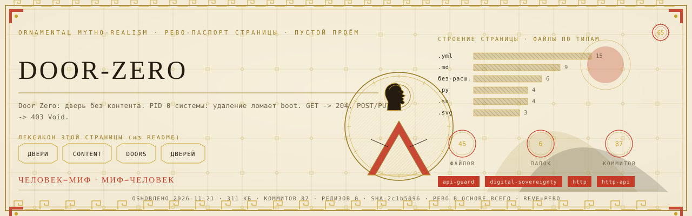

  

<!--ФОРЖ:МУЗА:НАЧАЛО-->

  
   
  

<!--ФОРЖ:МУЗА:КОНЕЦ-->

<!--ФОРЖ:ПАСПОРТ:НАЧАЛО-->

  

| ФАЙЛОВ | ПАПОК | КОММИТОВ | ОБНОВЛЕНО | РЕЛИЗОВ |
|---:|---:|---:|---|---:|
| 35 | 5 | 55 | 2026-11-19 | 0 |
<!--ФОРЖ:ПАСПОРТ:КОНЕЦ-->

# Door Zero — дверь, которой нет

Не содержит контента. Не собирает данных. Не имеет владельца среди частей.
Существует, чтобы система знала: есть место, куда не надо.

    make check    # boot-проверка: пустота на месте
    make test     # 204 / 403 Void / удаление ломает boot
    make serve    # GET -> 204 No Content, POST/PUT -> 403 Void

Удаление Двери Zero ломает boot. Это не баг — это контракт.

## Что это

PID 0 в Linux невидим: без файлов, без логов, без имени — но PID 1 без него
не стартует. Door Zero — то же самое для системы дверей: ноль контента,
ноль телеметрии, ноль владельца среди частей — и без неё система не
считается собранной.

Номера дверей держит doors.json (52 двери). Door Zero вне нумерации:
не 53-я дверь — дыра нумерации, через которую видно целое.

## EN — what this is

Door Zero holds no content, collects no data, and has no owner among the
parts. It exists so the system knows there is a place you do not need to
go. Removing it breaks boot. GET -> 204 No Content; POST/PUT -> 403 Void.
It has no door number: doors.json keeps the 52 numbers; Door Zero is
outside numbering — the hole through which the whole is visible.

## Границы (честно)

- заморожена по построению: PR, заполняющий пустоту, отклоняется (403 Void);
- подтверждает носитель PID1, не рой: рой готовит, хозяин закрывает;
- «нечего улучшать» — жанр, не метрика; машинный эквивалент — test_boot_fail
  (красный при удалении двери).

## Дом

- Ядро дома — [polymath-core](https://github.com/rtynbirf/polymath-core); живой реестр аккаунта — [index](https://github.com/rtynbirf/index).
- Номера остальных дверей держит `doors.json` в хозяйской стороне; эта дверь — вне нумерации.
- Лицензия — MIT ([LICENSE](LICENSE)). Существование двери проверяется `make check`; удаление красит `test_boot_fail` — и boot честно падает.
